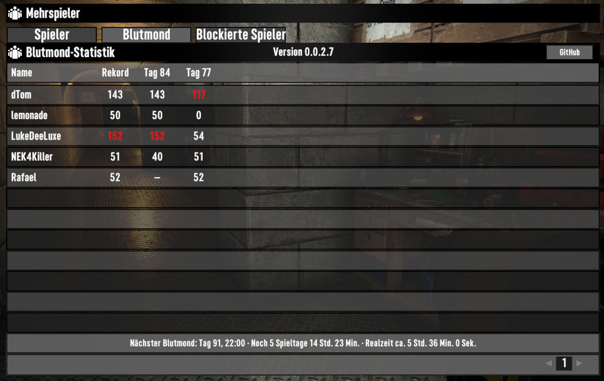

# Mod_Statistik

Blutmond-Kills für 7 Days to Die: laufende Werte, persönliche Rekorde und abgeschlossene Nächte im Spiel anzeigen.

**Projektversion: 0.2.0.0 · Direkt-Sync**

[Aktuelle Version herunterladen](https://github.com/NAS4Killer/Mod_Statistik/releases/tag/direkt-sync-v0.2.0.0) · [Versionsübersicht](CHANGELOG.md) · [Offene Aufgaben](TODO.md)

## Anzeige

- Im Spielermenü zeigt der Tab **Blutmond** die Spieler untereinander, ihren Rekord und die Blutmondtage. Höchstwerte sind rot markiert, auch bei Gleichstand.
- Unter der Tabelle stehen der nächste Blutmond, die verbleibenden Spieltage und die geschätzte Realzeit.
- Die eigene rote Killzahl wird während des Blutmonds aktualisiert und bleibt danach 60 echte Sekunden sichtbar.
- Originale Gruppenzeilen erhalten eine Killspalte. Eigene Werte sind rot, andere weiß; ein roter Stern kennzeichnet den höchsten positiven Gruppenwert. Bei Gleichstand erhalten alle Führenden einen Stern.

Screenshot1 zeigt den bestätigten Tabellenstand **0.0.2.7**. Spielernamen sind anonymisiert; die aktuelle Veröffentlichung ist **0.2.0.0**.

## Installation

1. Spiel bzw. Spielserver beenden und vorhandene Mod-Daten sichern.
2. Das Release-ZIP im `Mods`-Ordner entpacken. Danach liegt `Mod_Statistik/ModInfo.xml` direkt darunter.
3. Der Server benötigt die Mod. Spieler ohne Mod können beitreten und werden mitgezählt. Für Tabelle und zusätzliche Killanzeigen benötigen Spieler die passende Mod-Version.
4. Bei einer Aktualisierung den vorhandenen gesamten Ordner `Mod_Statistik/Data` erhalten. Die mitgelieferte TXT enthält historische Beispieldaten; eine eigene Statistik nicht damit überschreiben.

**Wechsel auf 0.2.0.0:** manuell aus dem ZIP installieren, den vorhandenen Data-Ordner erhalten und die alten Config/XUi_InGame-Patchdateien entfernen. Ältere Updater unterstützen die neuen Abhängigkeiten noch nicht.

## Aufzeichnung und Übertragung

Die Mod erstellt und ergänzt `Data/bloodmoon_kills.txt` im Mod-Ordner. Im lokalen Spiel zeichnet das Spiel auf; auf einem dedizierten Server zeichnet der Server auf. Verbundene Spieler erhalten die Statistik über die bestehende Spielverbindung.

Die Zählung beginnt zum konfigurierten Blutmondstart, normalerweise um 22 Uhr, und endet zum konfigurierten Ende, normalerweise um 4 Uhr. Währenddessen werden Killwerte einmal pro echter Sekunde erfasst. Zwischenstände werden bei Änderungen alle fünf echten Sekunden und beim Ausloggen bzw. Weltende gesichert.

Bestehende Nächte bleiben erhalten. Ein Beitritt mitten in der Nacht zählt ab diesem Zeitpunkt. Bei einem Absturz kann der noch nicht gesicherte Zeitraum fehlen. Eine externe Aufzeichnung darf nicht gleichzeitig dieselbe TXT beschreiben.

Die SecondMap kann die Mod-Daten lesen; ihre bisherige Kill-Aufzeichnung muss dabei deaktiviert werden. Diese externe Einrichtung gehört nicht zum Installationspaket der Mod.

## Prüfstand

Lokale Aufzeichnung, Fehlerkorrektur und 60-Sekunden-Anzeige wurden im Spiel bestätigt. Der NUC-Server startet mit der Mod; die echte Statistikübertragung und das Tabellenlayout sind bestätigt. Automatisierte Tests prüfen unter anderem acht simulierte Spieler, Paketübertragung, Gruppenrangfolge und Gleichstände.

Serverbeitritt ohne Mod und Gegentest mit Mod wurden vom Nutzer bestätigt.

**Noch offen:** gemeinsamer Test mit einer echten Gruppe während des Blutmonds, Anzeige der Endwerte für 60 Sekunden und Verhalten nach einem Neustart.

## Veröffentlichungen

| Version | Schwerpunkt |
| --- | --- |
| [0.2.0.0](https://github.com/NAS4Killer/Mod_Statistik/releases/tag/direkt-sync-v0.2.0.0) | Serverbeitritt mit und ohne Mod; ausschließlich lokale Oberfläche |
| [0.1.0.0](https://github.com/NAS4Killer/Mod_Statistik/releases/tag/direkt-sync-v0.1.0.0) | Dedizierter Server, Server-HUD und Gruppen-Killanzeige |
| [0.0.2.0](https://github.com/NAS4Killer/Mod_Statistik/releases/tag/direkt-sync-v0.0.2.0) | Fehlerkorrektur und 60 Sekunden Anzeige nach dem Blutmond |
| [0.0.1.0](https://github.com/NAS4Killer/Mod_Statistik/releases/tag/direkt-sync-v0.0.1.0) | Direkt-Sync und automatische Blutmondstatistik |

## Übertragung ab 0.1.0.1

Die Statistik nutzt den vorhandenen zuverlässigen Pakettyp NetPackageChat. Reservierte Statistiknachrichten werden vor Anzeige und Weiterleitung abgefangen. Der normale Chat bleibt erhalten. Es gibt keine eigenen NetPackage-Unterklassen mehr. Der Server antwortet ausschließlich dem authentifizierten Spieler, dessen Mod die Statistik angefordert hat. Die mitgelieferte Harmony-Bibliothek mit ihren Abhängigkeiten dient dem Abfangen der Nachrichten.

## Lokale Oberfläche ab 0.1.0.2

Die Menüdefinitionen liegen in der DLL. Sie werden ausschließlich auf dem Mod-Spielclient in private Kopien der UI-Daten eingefügt. Spieler ohne Mod erhalten das unveränderte Menü. Bei manuellen Updates müssen die alten Dateien Config/XUi_InGame/windows.xml, templates.xml und xui.xml aus dieser Mod entfernt werden; das vollständige alte Mod-Verzeichnis unter Erhalt der Data-Dateien ersetzen.
