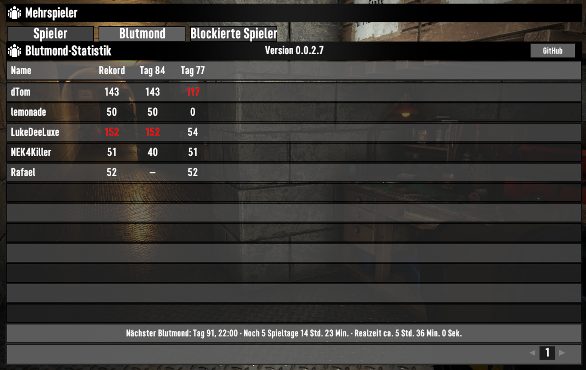

# Mod_Statistik

Blutmond-Statistik für 7 Days to Die: laufende Kills, persönliche Rekorde, abgeschlossene Nächte und Trefferquoten im Spiel anzeigen.

**Aktuelle Version: 0.3.1.0 · Trefferquote in Tabelle und HUD**

Client- und Server-DLL der Version 0.3.1.0 wurden lokal gegen die vorhandenen Spielbibliotheken von **V3.4.0 (b10)** erstellt. Der Funktionsstand wurde lokal im Spiel bestätigt.

[Version 0.3.1.0 herunterladen](https://github.com/NAS4Killer/Mod_Statistik/releases/tag/direkt-sync-v0.3.1.0) · [Versionsübersicht](CHANGELOG.md) · [Offene Aufgaben](TODO.md)

Das GitHub-Repository ist privat. Zum Öffnen der Release-Seite und Herunterladen der Pakete ist eine GitHub-Anmeldung mit Zugriff auf dieses Repository erforderlich.

## Anzeige

- Im Spielermenü zeigt der Tab **Blutmond** die Spieler untereinander, ihren Rekord und die Blutmondtage. Höchstwerte sind rot markiert, auch bei Gleichstand.
- Unter jeder Killzahl steht die Trefferquote dieser Blutmondnacht, zum Beispiel **75 %** oder **33,3 %**. Fehlende Schussdaten und null abgegebene Schüsse erscheinen als **—**; ausschließlich Fehlschüsse ergeben **0 %**.
- Unter der Tabelle stehen der nächste Blutmond, die verbleibenden Spieltage und die geschätzte Realzeit.
- Die eigene rote Killzahl wird während des Blutmonds aktualisiert und bleibt danach 60 echte Sekunden sichtbar.
- Rechts neben der eigenen Killzahl und den Killzahlen der Gruppenmitglieder steht zusätzlich die Trefferquote. Die höchste angezeigte Quote innerhalb der Gruppe ist grün; bei Gleichstand sind alle Bestplatzierten grün. Andere Quoten bleiben weiß. Fehlende Daten und null Schüsse zeigen **—** und erhalten keine Spitzenmarkierung.
- Originale Gruppenzeilen erhalten eine Killspalte. Eigene Werte sind rot, andere weiß; ein roter Stern kennzeichnet den höchsten positiven Gruppenwert. Bei Gleichstand erhalten alle Führenden einen Stern.

Screenshot1 zeigt den historischen Tabellenstand **0.0.2.7**. Spielernamen sind anonymisiert; die später ergänzte Trefferquote ist darin noch nicht enthalten.

## Trefferquote

Die Quote lautet: **Patronen mit mindestens einem Treffer auf einen lebenden Zombie ÷ abgefeuerte Patronen × 100**. Zombie-Tiere zählen ebenfalls. Der tödliche Treffer zählt; Treffer auf bereits tote Körper zählen nicht. Eine Schrotpatrone oder ein Durchschuss mit mehreren Treffern gilt höchstens als ein erfolgreicher Schuss. Die Quote bleibt dadurch höchstens 100 %.

Erfasst werden die aktuellen Vanilla-Patronenwaffen während der Blutmondnacht. Bögen, Armbrüste, Raketen, Sprengstoffe, andere Projektilwaffen, Werkzeuge, Geschütztürme und Admin-Waffen gehören nicht zu dieser Erfassung. Nachladen und ein leerer Abzug zählen nicht als Schuss.

Für die Trefferquote benötigen der jeweilige Spieler und der aufzeichnende Spielhost eine Mod-Version mit Schusserfassung; für den vollständigen Funktionsstand verwenden beide Version 0.3.1.0. Die Schusswerte stammen vom jeweiligen Mod-Client. Spieler ohne Mod werden weiterhin bei den Kills mitgezählt; ihre Trefferquote bleibt **—**. Beim Verbinden mit einer älteren Server-Mod bleibt die bisherige Killstatistik über den bisherigen Übertragungsweg verfügbar. Historische Trefferquoten werden nicht aus Killzahlen nachträglich berechnet.

Die Änderungen sind in [ReleaseNotes-0.3.1.0.txt](ReleaseNotes-0.3.1.0.txt) zusammengefasst. Der Nutzer hat die lokale Schusserfassung und anschließend die Trefferquote neben den Kills im Spiel bestätigt. Die damaligen Testabläufe bleiben unter [LocalTest-0.3.0.0.txt](LocalTest-0.3.0.0.txt) und [LocalTest-0.3.0.1.txt](LocalTest-0.3.0.1.txt) dokumentiert.

## Installation

1. Spiel bzw. Spielserver beenden und vorhandene Mod-Daten sichern.
2. Das Release-ZIP im `Mods`-Ordner entpacken. Danach liegt `Mod_Statistik/ModInfo.xml` direkt darunter.
3. Der Server benötigt die Mod. Spieler ohne Mod können beitreten und werden mitgezählt. Für Tabelle und zusätzliche Killanzeigen benötigen Spieler die passende Mod-Version.
4. Bei einer Aktualisierung den vorhandenen gesamten Ordner `Mod_Statistik/Data` erhalten. Die mitgelieferte TXT enthält historische Beispieldaten; eine eigene Statistik nicht damit überschreiben.

**Umstieg von Versionen vor 0.2.0.0:** manuell aus dem ZIP installieren, den vorhandenen Data-Ordner erhalten und die alten Config/XUi_InGame-Patchdateien entfernen. Diese älteren Updater unterstützen die seit 0.2.0.0 benötigten Abhängigkeiten noch nicht.

## Aufzeichnung und Übertragung

Die Mod erstellt und ergänzt `Data/bloodmoon_kills.txt` im Mod-Ordner. Im lokalen Spiel zeichnet das Spiel auf; auf einem dedizierten Server zeichnet der Server auf. Verbundene Spieler erhalten die Statistik über die bestehende Spielverbindung.

Die Zählung beginnt zum konfigurierten Blutmondstart, normalerweise um 22 Uhr, und endet zum konfigurierten Ende, normalerweise um 4 Uhr. Währenddessen werden Killwerte einmal pro echter Sekunde erfasst. Zwischenstände werden bei Änderungen alle fünf echten Sekunden und beim Ausloggen bzw. Weltende gesichert.

Bestehende Nächte bleiben erhalten. Ein Beitritt mitten in der Nacht zählt ab diesem Zeitpunkt. Bei einem Absturz kann der noch nicht gesicherte Zeitraum fehlen. Eine externe Aufzeichnung darf nicht gleichzeitig dieselbe TXT beschreiben.

Die SecondMap kann die Mod-Daten lesen; ihre bisherige Kill-Aufzeichnung muss dabei deaktiviert werden. Diese externe Einrichtung gehört nicht zum Installationspaket der Mod.

Trefferwerte liegen getrennt in `Data/bloodmoon_accuracy-<Weltkennung>.json`. Die vorhandene Kill-TXT behält ihr Format. Änderungen werden gesammelt alle fünf echten Sekunden und beim Ausloggen bzw. Weltende atomar gespeichert. Beschädigte Trefferdateien bleiben erhalten und lösen eine Fehlermeldung aus. Auch diese Dateien gehören zur Sicherung des gesamten Data-Ordners.

Der neue Übertragungsweg tauscht die laufende Nacht etwa einmal pro Sekunde separat aus. Abgeschlossene Nächte werden beim ersten Abruf und bei geänderter Historie übertragen. Ein einzelner Schuss löst weder eine eigene Dateioperation noch einen vollständigen Historientransfer aus.

## Prüfstand

**Funktionsstand 0.3.1.0:** Schusserfassung, Tabellenquote und die zusätzliche Anzeige rechts neben den Kills wurden vom Nutzer lokal im Spiel bestätigt. Die Bestätigung erfolgte mit den lokalen Zwischenständen 0.3.0.0 und 0.3.0.1. Alle 13 Testsuiten bestanden, darunter 326 Protokollprüfungen, 15 Trefferstatistik-Integrationsfälle sowie Tests für Harmony-Hooks, Farben, Gruppenwechsel, Gleichstände und Positionierung. Die lokale Oberfläche wurde gegen originale XUi-Dateien geprüft.

Projekt, Spielinstallation und Spielstände wurden vor der Erweiterung gesichert und per SHA-256 geprüft; vor der HUD-Ergänzung wurden Projekt, installierte Mod und aktuelle Spielstände erneut gesichert. Bestehende Mod-Daten und originale Spielassemblies blieben erhalten. Die letzte bestätigte lokale Installation trägt Version 0.3.0.1; 0.3.1.0 fasst diesen bestätigten Funktionsstand zusammen. Ein Server wurde für diese Erweiterung nicht verändert.

**Bisherige Versionen bis 0.2.0.0:** Lokale Aufzeichnung, Fehlerkorrektur und 60-Sekunden-Anzeige wurden im Spiel bestätigt. Der NUC-Server startete im dokumentierten Test mit der Mod; die echte Statistikübertragung und das Tabellenlayout wurden bestätigt. Automatisierte Tests prüfen unter anderem acht simulierte Spieler, Paketübertragung, Gruppenrangfolge und Gleichstände.

Serverbeitritt ohne Mod und Gegentest mit Mod wurden vom Nutzer bestätigt.

**Noch offen:** gemeinsamer Test mit einer echten Gruppe während des Blutmonds, Anzeige der Endwerte für 60 Sekunden und Verhalten nach einem Neustart.

## Veröffentlichungen

| Version | Schwerpunkt |
| --- | --- |
| [0.3.1.0](https://github.com/NAS4Killer/Mod_Statistik/releases/tag/direkt-sync-v0.3.1.0) | Trefferquote in Tabelle und HUD; beste Gruppenquote grün, einschließlich Gleichständen |
| [0.2.0.0](https://github.com/NAS4Killer/Mod_Statistik/releases/tag/direkt-sync-v0.2.0.0) | Serverbeitritt mit und ohne Mod; ausschließlich lokale Oberfläche |
| [0.1.0.0](https://github.com/NAS4Killer/Mod_Statistik/releases/tag/direkt-sync-v0.1.0.0) | Dedizierter Server, Server-HUD und Gruppen-Killanzeige |
| [0.0.2.0](https://github.com/NAS4Killer/Mod_Statistik/releases/tag/direkt-sync-v0.0.2.0) | Fehlerkorrektur und 60 Sekunden Anzeige nach dem Blutmond |
| [0.0.1.0](https://github.com/NAS4Killer/Mod_Statistik/releases/tag/direkt-sync-v0.0.1.0) | Direkt-Sync und automatische Blutmondstatistik |

## Übertragung ab 0.1.0.1

Die Statistik nutzt den vorhandenen zuverlässigen Pakettyp NetPackageChat. Reservierte Statistiknachrichten werden vor Anzeige und Weiterleitung abgefangen. Der normale Chat bleibt erhalten. Es gibt keine eigenen NetPackage-Unterklassen mehr. Der Server antwortet ausschließlich dem authentifizierten Spieler, dessen Mod die Statistik angefordert hat. Die mitgelieferte Harmony-Bibliothek mit ihren Abhängigkeiten dient dem Abfangen der Nachrichten.

## Lokale Oberfläche ab 0.1.0.2

Die Menüdefinitionen liegen in der DLL. Sie werden ausschließlich auf dem Mod-Spielclient in private Kopien der UI-Daten eingefügt. Spieler ohne Mod erhalten das unveränderte Menü. Bei manuellen Updates müssen die alten Dateien Config/XUi_InGame/windows.xml, templates.xml und xui.xml aus dieser Mod entfernt werden; das vollständige alte Mod-Verzeichnis unter Erhalt der Data-Dateien ersetzen.

## Weiterentwicklung

Quellcode: `src/`, Tests: `tests/`. Build, Architektur, Datenformat, Entscheidungen, Pruefstand und Veroeffentlichung: [DEVELOPMENT.md](DEVELOPMENT.md).
